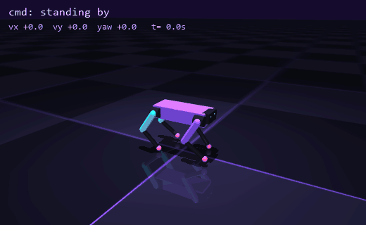
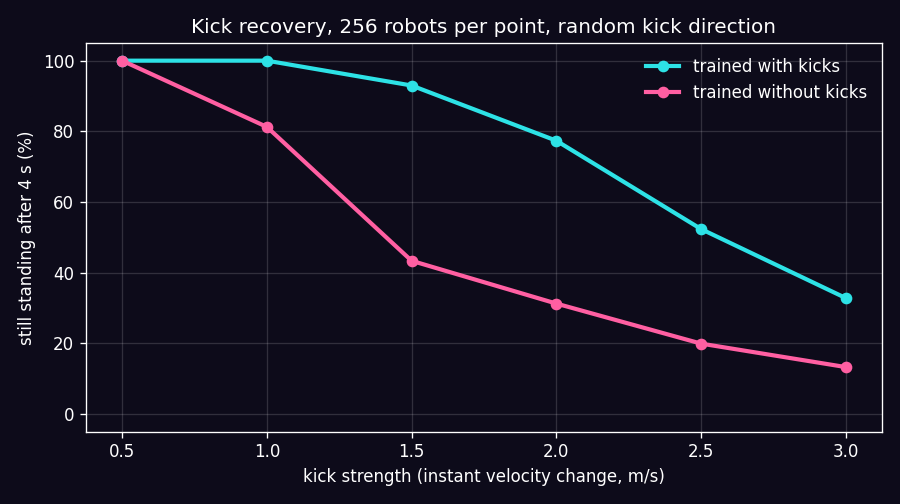
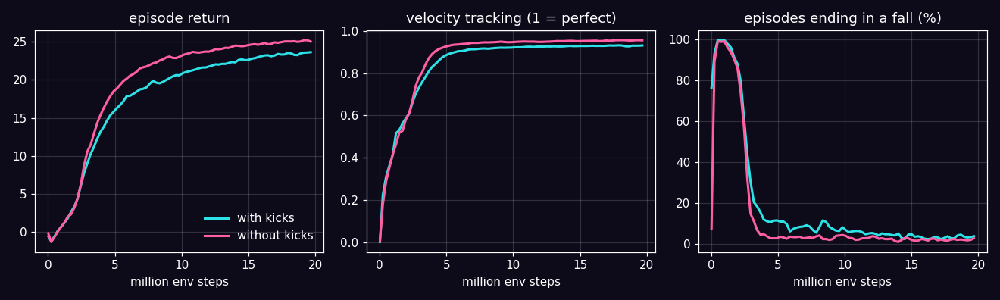

# ZOOMIES

> A four-legged robot I designed, a reinforcement learning algorithm I wrote from scratch, and 1024 copies of the robot falling over in parallel until they stop falling over.
> Twenty minutes later it walks, turns, strafes, and takes a kick without eating the floor.



*One policy, steered by velocity commands: walk, turn, strafe, then two kicks (1.25 m/s and 1.1 m/s of instant velocity change, red arrows). Nothing here is scripted motion. Every joint target comes from a neural network that learned by trial and error.*

---

## TL;DR

- **Zoomie**: a 12-motor, 10 kg quadruped designed for this project in MuJoCo.
- **PPO from scratch** in PyTorch: GAE, clipped objectives, observation normalization, adaptive learning rate, time-limit bootstrapping. No Stable-Baselines, no RL library.
- **1024 robots in parallel** on MuJoCo's C thread pool, about 19k env steps per second *including* learning, on a laptop.
- **Tracks velocity commands** almost exactly: asked for 1.0 m/s forward, it does 1.00.
- **Kick-proof-ish**: trained with random shoves, it survives a 1.5 m/s kick 93% of the time. The same robot trained without kicks: 43%.
- 19.7M env steps, about 20 minutes of training when the laptop isn't busy with anything else.

## The robot

Zoomie is a box torso (5 kg) with four legs, three motors each: hip roll, hip pitch and knee. Thighs and calves are 18 cm, feet are little spheres, and the total mass is 10.2 kg. Each motor is a position servo ($k_p = 30$, torque limit 25 Nm). The policy doesn't output torques. It outputs joint *targets* around a crouched standing pose, and the servos do the rest. That one design choice makes learning dramatically easier, and it's what most real legged robots do.

## How it works

### 1. A thousand robots at once

RL needs a ridiculous amount of experience, so the env is built for throughput. All 1024 robots live as rows of one big state array. Each policy step:

1. actions $\to$ joint targets $q^{target} = q^{default} + 0.25\,a$,
2. `mujoco.rollout` advances every robot by 4 physics steps (5 ms each, so the policy runs at 50 Hz) across all CPU cores in C,
3. observations, rewards, falls and resets are computed for the whole batch at once in NumPy.

No Python loop over robots anywhere. Raw env speed is about 59k steps/s. With the GPU running the policy and PPO updates on top, it's about 19k steps/s.

### 2. What the robot feels (48 numbers)

Body-frame linear and angular velocity, gravity direction in the body frame (that's how it knows it's tilting), the velocity command, 12 joint angles, 12 joint velocities, and its previous action. All of it gets a bit of noise, because real sensors are never clean.

### 3. What it's rewarded for

| Term | Formula | Why |
|---|---|---|
| Track velocity | $\exp(-\lVert v^{cmd}_{xy} - v_{xy}\rVert^2 / 0.25)$ | the actual job |
| Track turning | $\exp(-(\omega^{cmd}_z - \omega_z)^2 / 0.25)$ | the actual job, part 2 |
| Feet air time | $\sum_{feet} (t_{air} - 0.25)$ on touchdown | take real steps instead of shuffling |
| Vertical bounce | $-v_z^2$ | no pogo-sticking |
| Wobble | $-\lVert\omega_{xy}\rVert^2$, $-\lVert g_{xy}\rVert^2$ | stay level |
| Height | $-(h - 0.27)^2$ | don't belly-crawl |
| Torque, action rate | $-\lVert\tau\rVert^2$, $-\lVert a_t - a_{t-1}\rVert^2$ | smooth and efficient, no jitter |
| Joint limits | $-$distance past the limits | don't fold yourself in half |

An episode ends when the torso tilts past 60 degrees or drops below 12 cm, or after 20 seconds.

### 4. PPO, from scratch

The policy is a Gaussian $\pi_\theta(a\,|\,s) = \mathcal{N}(\mu_\theta(s), \sigma)$ from an MLP (512-256-128, ELU), with a separate critic $V_\phi(s)$. Each update collects 24 steps from all 1024 robots (about 25k transitions), then:

- **Advantages** with GAE: $\hat A_t = \sum_l (\gamma\lambda)^l \delta_{t+l}$, $\delta_t = r_t + \gamma V(s_{t+1}) - V(s_t)$, with $\gamma = 0.99$, $\lambda = 0.95$.
- **Clipped surrogate**: maximize $\mathbb{E}\big[\min(\rho_t \hat A_t,\ \mathrm{clip}(\rho_t, 0.8, 1.2)\,\hat A_t)\big]$ with $\rho_t = \pi_\theta(a_t|s_t) / \pi_{old}(a_t|s_t)$. Translation: improve, but not so much in one step that you wreck what already works.
- **Adaptive learning rate**: estimate the KL divergence between the old and new policy after every minibatch. Too big, the LR drops; too small, it grows.
- **Time-limit bootstrapping**: hitting the 20 s limit isn't the robot's fault, so the reward gets $+\gamma V(s_T)$ instead of pretending the world ended. Skip this and the critic learns that life is meaningless after 20 seconds, which is relatable, but bad for walking.
- Plus running observation normalization, a clipped value loss, gradient clipping and a small entropy bonus.

The tests check GAE against a hand computation and make sure PPO actually solves a toy problem whose answer is known.

### 5. Kicks and domain randomization

During training, every robot gets shoved every 4 to 8 seconds: an instant velocity change of up to 1 m/s on each horizontal axis. On top of that, the 1024 robots are spread over 32 physics variants with different floor friction (0.4 to 1.25) and torso mass (-1 kg to +2 kg), so the policy can't overfit to one perfect world.

## Results

All numbers below are from `scripts/evaluate.py` and `scripts/kick_directions.py`. They use 256 robots per test, with fresh friction and mass randomization, and the deterministic policy.

### It goes where you tell it

Hold a command for 10 seconds and measure the average velocity (policy trained with kicks):

| Command (vx, vy, yaw) | Achieved | Fell |
|---|---|---|
| stand still | +0.00, -0.00, -0.01 | 0% |
| 0.5 m/s forward | +0.49, -0.01, -0.03 | 0% |
| 1.0 m/s forward | +1.00, -0.01, -0.03 | 0% |
| 0.4 m/s backward | -0.39, -0.00, -0.02 | 0% |
| 0.4 m/s sideways | +0.00, +0.38, -0.03 | 0% |
| turn in place, 0.8 rad/s | +0.01, -0.01, +0.72 | 0.8% |
| 0.6 m/s forward + 0.6 rad/s turn | +0.60, +0.02, +0.57 | 0% |

### It takes a kick

Walking at 0.5 m/s, kicked once from a random direction, still standing 4 seconds later:



| Kick strength | 0.5 m/s | 1.0 m/s | 1.5 m/s | 2.0 m/s | 2.5 m/s | 3.0 m/s |
|---|---|---|---|---|---|---|
| **Trained with kicks** | 100% | 100% | **93%** | 77% | 52% | 33% |
| Trained without kicks | 100% | 81% | 43% | 31% | 20% | 13% |

And by direction, walking at 0.6 m/s (trained with kicks):

| Kick direction | 1.0 m/s | 1.25 m/s | 1.5 m/s |
|---|---|---|---|
| from behind | 100% | 100% | 96% |
| from the front | 100% | 100% | 100% |
| from the side | 100% | 100% | 98% |

The GIF uses 1.25 and 1.1 m/s kicks, strengths it survived every single time in this test. A 1.5 m/s side kick knocked it over in one of my GIF takes, which fits the few percent of falls at 1.5 m/s in the table. I'd rather show you the numbers than a lucky take.

### Training



Both runs: 800 PPO iterations, 19.7M env steps, same seed, same everything except the kicks.

**The honest breakdown:**

- **The training curves lie, a little.** The run without kicks reaches a *higher* return (25.0 vs 23.6) and falls less during training (2.6% vs 3.6%). That's because its world is easier, not because it's better. Put both in the same world with a kick and it's 43% vs 93%. Lesson: evaluate on what you care about, not on the training reward.
- **The kick-free policy also forgot how to turn in place.** Asked for 0.8 rad/s with zero forward speed, it manages 0.15. The kicks seem to force the policy to learn more varied foot placement, and that pays off for turning too. That's my reading of it, not a proven result.
- **Turning in place is the weakest command overall**: 0.72 of the asked 0.8 rad/s, and the only command with any falls (0.8%).
- **Training was stopped at 800 of the planned 1500 iterations.** Another experiment was sharing the laptop and slowed things down 3x, and the curves had flattened out by then. Both runs got the same budget, so the comparison stays fair.
- **What's still sim-only**: the policy sees its exact body velocity, which a real robot would have to estimate. The ground is flat, the motors are ideal servos, and there's no sensor latency. Those are the gaps a sim-to-real project has to close.

## Running it

```bash
pip install -r requirements.txt
```

Drive it yourself: arrow keys walk and turn, `,` and `.` strafe, **space kicks it**, `0` stops.

```bash
python scripts/play.py
```

Train your own (about 20 minutes on a laptop GPU plus a multi-core CPU):

```bash
python scripts/train.py --iters 800 --run main
```

```bash
python scripts/train.py --iters 800 --run no_push --no-push
```

Evaluate, plot and render:

```bash
python scripts/evaluate.py --policies main no_push
```

```bash
python scripts/kick_directions.py
```

```bash
python scripts/plot_training.py main no_push
```

```bash
python scripts/render_gif.py
```

```bash
python -m pytest
```

Trained weights for both policies are in `checkpoints/`, so `play.py` and the evaluations work without training anything.

## What's where

```
zoomies/
  robot.py     # the quadruped, generated as MJCF
  env.py       # 1024 parallel envs: observations, rewards, kicks, randomization, resets
  ppo.py       # PPO from scratch: actor-critic, GAE, clipped losses, adaptive LR
  policy.py    # load a checkpoint, kick a robot
scripts/
  train.py, evaluate.py, kick_directions.py, plot_training.py, render_gif.py, play.py
checkpoints/   # trained weights + training logs for both runs
tests/         # env physics/layout checks, GAE by hand, PPO on a toy problem
```

## Roadmap

Part of a "physical AI from scratch" series:

- [x] [ARMageddon](https://github.com/nonberw/armageddon): inverse kinematics for a robot arm
- [x] [YOINK](https://github.com/nonberw/yoink): vision-based pick-and-place
- [x] [COPYCAT](https://github.com/nonberw/copycat): imitation learning from demonstrations
- [x] **ZOOMIES**: RL locomotion
- [ ] Sim-to-real on an actual robot

Next for ZOOMIES: rough terrain and stairs (heightfields plus a curriculum), a velocity estimator instead of the privileged velocity, motor latency and actuator models, and maybe a backflip if I'm feeling brave.

## FAQ

**Why write PPO yourself?**
Because "I imported a library and it walked" teaches you nothing about *why* it walked. Writing GAE by hand is the fastest way to actually understand what advantage estimation is doing.

**Why kick your own robot?**
Because the real world will. A policy that only ever saw perfect conditions is 43% likely to faceplant from a medium shove. Ten seconds of simulated bullying per episode fixes most of that.

**Is the robot okay?**
It's a simulation. No Zoomies were harmed. Several thousand fell over, but they got reset.

**Why ZOOMIES?**
It's what dogs do when they randomly sprint around the house. Also the name was free.

## License

[MIT](LICENSE)
